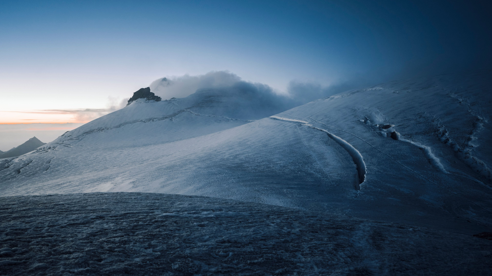

# Everest

**A calm, cohesive, modern Linux desktop built on Omarchy.**

Everest builds on Omarchy to create a desktop with the ease, consistency, and
attention to detail associated with macOS. It brings that care to everyday
interaction: opening applications, arranging windows, changing settings, reading
notifications, and keeping the system up to date.

Omarchy provides the technical foundation. Everest shapes the experience around
comfortable graphical controls, thoughtful defaults, and a distinct visual
identity inspired by mountain landscapes.

## The desktop we want

- **One visual language.** Typography, spacing, colors, icons, and motion feel
  consistent across the shell and common applications. Dawn is light; Dusk is dark.
- **Comfortable window management.** Floating windows, clear window controls,
  predictable switching, and useful gestures, with tiling available when wanted.
- **Graphical everyday tasks.** People can find applications, connect devices,
  adjust displays, change appearance, and manage their desktop through clear controls.
- **A quieter environment.** Useful information is easy to find. Technical detail
  stays available without filling the default interface.
- **Care through the whole lifecycle.** Setup, updates, errors, recovery, and
  removal receive the same attention as the visible desktop.

The macOS influence guides interaction quality and visual care. Everest has its
own identity and follows Linux application and system constraints.

Read the [vision and design principles](VISION.md) and the
[roadmap with acceptance criteria](ROADMAP.md).

## Current state: early prototype

The repository contains an initial desktop layer targeting **Omarchy 4.0.6**.
It has code for Dawn and Dusk appearances, photographic backgrounds, a top bar,
a separate application dock, a graphical Settings entry point, proportional shell
typography, floating windows, Super-key shortcuts, and a reversible installer.

Settings currently opens existing Omarchy controls. Installation, updates, and
recovery still use command-line tools. Window controls, application consistency,
and several desktop interactions need further work.

**A real Omarchy graphical session has not yet been tested.** Automated checks
cover source formats, installer behavior, recovery, switching helpers, bundled
assets, and an isolated typography binding. They do not establish that the
desktop looks or behaves correctly on hardware.

The next milestone is to validate this foundation in a real session, record the
results, and fix the gaps. See the [roadmap](ROADMAP.md) and
[graphical acceptance checklist](docs/testing.md).

## Explore the project

| Document | Purpose |
|---|---|
| [Vision](VISION.md) | Product direction and the experience Everest should deliver |
| [Roadmap](ROADMAP.md) | Priorities, current gaps, and evidence needed for each milestone |
| [Install and use](docs/install.md) | Prototype requirements, setup, updates, removal, and known limitations |
| [Shortcuts](docs/shortcuts.md) | Current keyboard and window behavior |
| [Architecture](docs/architecture.md) | Inspected upstream interfaces and implementation decisions |
| [Testing](docs/testing.md) | Automated coverage and outstanding graphical acceptance |
| [Contributing](CONTRIBUTING.md) | How to propose and validate changes that fit the project |

## Dawn and Dusk

The visual direction uses restrained color and real mountain photography.
These are the bundled backgrounds. Desktop screenshots will be added after
graphical validation.

View the Dawn and Dusk backgrounds

### Dawn

### Dusk

## Built on Omarchy

Everest currently works through user configuration, supported shell plugins, and
theme interfaces. Omarchy retains its update mechanism, core shell services,
lock screen, and authentication agent. Compatibility is tied to an inspected
upstream version; see [upstream.lock.json](upstream.lock.json).

This repository is authored directly on GitHub. No local checkout or project
downloads were used on the authoring machine.

## License

Code and palettes are MIT licensed; see [LICENSE](LICENSE) and [NOTICE](NOTICE).
Bundled photographs have a separate [asset license](assets/LICENSE.txt), which
does not require attribution. Installed system icons and runtime dependencies
retain their respective licenses. No Apple assets are included.
